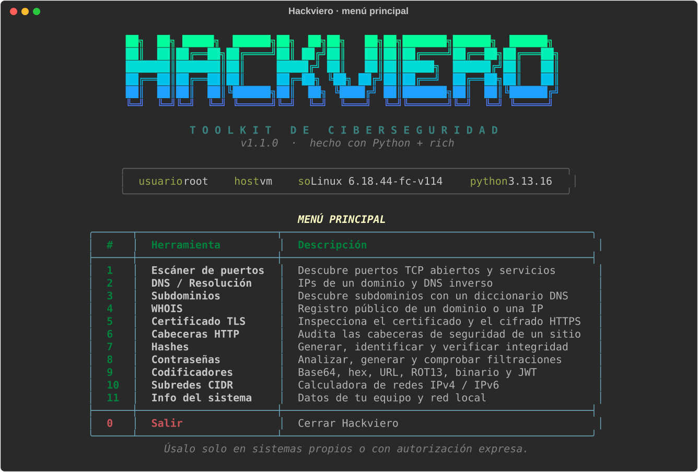
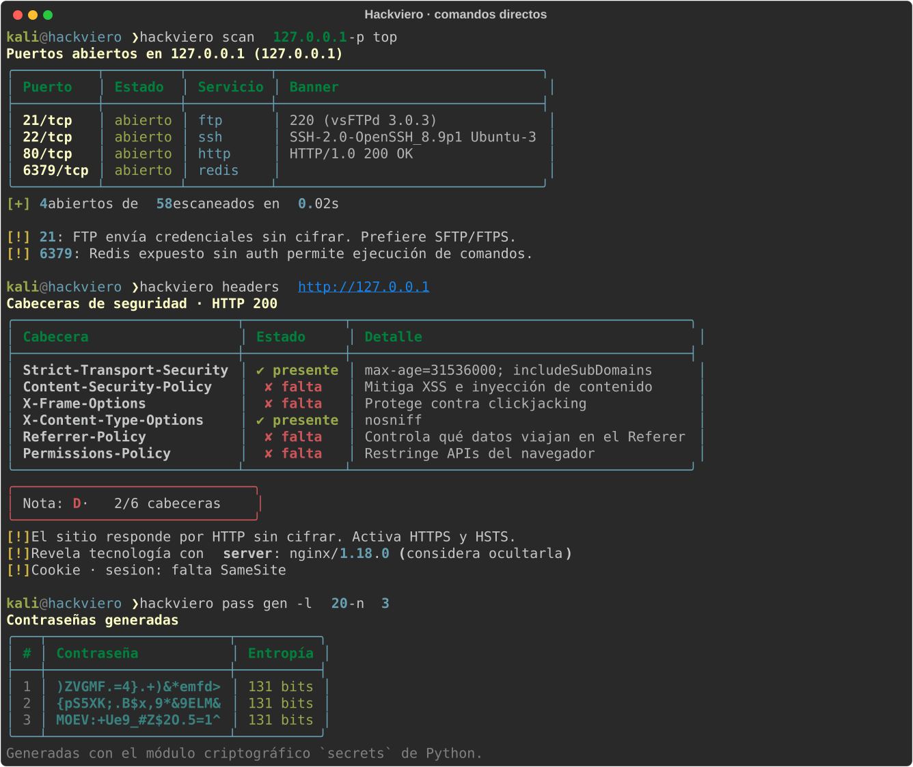

<div align="center">

# HACKVIERO

**Toolkit de ciberseguridad para la terminal — bonito, rápido y en español.**




</div>

Hackviero reúne en un solo comando las utilidades de reconocimiento y análisis que más se usan en
auditorías, CTF y administración de sistemas. Funciona de dos formas:

- **Menú interactivo** — ejecuta `hackviero` y navega por las herramientas.
- **Comandos directos** — `hackviero scan ejemplo.com`, pensados para scripts y pipelines.

Es un único archivo Python (`hackviero.py`) con **una sola dependencia**: [`rich`](https://github.com/Textualize/rich).

## Herramientas

| # | Herramienta | Qué hace | Comando |
|---|-------------|----------|---------|
| 1 | **Escáner de puertos** | Connect scan TCP multihilo, lectura de banners, avisos de servicios riesgosos y exportación a JSON | `scan` |
| 2 | **DNS / Resolución** | IPv4, IPv6, alias y DNS inverso | `dns` |
| 3 | **Subdominios** | Descubrimiento por diccionario (integrado o propio) con detección de DNS *wildcard* | `subs` |
| 4 | **WHOIS** | Registro de dominios e IPs, siguiendo IANA → registro → registrador | `whois` |
| 5 | **Certificado TLS** | Emisor, titular, caducidad, nombres alternativos, protocolo y cifrado | `tls` |
| 6 | **Cabeceras HTTP** | Nota de A+ a F, cookies inseguras y tecnologías expuestas | `headers` |
| 7 | **Hashes** | Genera 9 algoritmos, identifica tipos de hash y verifica la integridad de archivos | `hash` |
| 8 | **Contraseñas** | Análisis de entropía, generador criptográfico y comprobación de filtraciones (HIBP) | `pass` |
| 9 | **Codificadores** | Base64, Base32, hex, URL, ROT13, binario y decodificador de JWT | `enc`, `jwt` |
| 10 | **Subredes CIDR** | Calculadora IPv4/IPv6 con división en subredes | `subnet` |
| 11 | **Info del sistema** | Datos de tu equipo y de tu red local | `sys` |

## Instalación

### Kali Linux / Debian / Ubuntu

```bash
git clone https://github.com/TU_USUARIO/Hackviero.git
cd Hackviero
bash install.sh
hackviero
```

`install.sh` usa `pipx` si lo tienes; si no, crea un entorno virtual aislado y enlaza el comando en `~/.local/bin`.
(Kali y otras distros modernas bloquean `pip install` global por [PEP 668](https://peps.python.org/pep-0668/); por eso se instala aislado.)

### Con pipx o pip

```bash
pipx install .                 # recomendado
# o, dentro de un entorno virtual:
python3 -m venv .venv && source .venv/bin/activate && pip install .
```

### Sin instalar nada

```bash
pip install rich
python3 hackviero.py
```

## Uso

```bash
hackviero                                   # menú interactivo
hackviero --help                            # todos los comandos
```

```bash
hackviero scan 192.168.1.10                 # puertos comunes
hackviero scan ejemplo.com -p 1-1024 -o informe.json
hackviero scan 10.0.0.5 -p 22,80,443 --no-banner -y
hackviero dns ejemplo.com
hackviero subs ejemplo.com -l mi-lista.txt
hackviero whois ejemplo.com --raw
hackviero tls ejemplo.com:8443
hackviero headers https://ejemplo.com

hackviero hash text "hola"
hackviero hash file ./imagen.iso
hackviero hash verify ./imagen.iso 9f86d081884c7d659a2feaa0c55ad015a3bf4f1b2b0b822cd15d6c15b0f00a08
hackviero hash id 5f4dcc3b5aa765d61d8327deb882cf99

hackviero pass gen -l 24 -n 5 --avoid-ambiguous
hackviero pass check                        # la contraseña se pide oculta
hackviero pass pwned                        # ¿apareció en filtraciones?

hackviero enc b64 "Hackviero"
hackviero enc b64 "SGFja3ZpZXJv" -d
hackviero jwt eyJhbGciOiJIUzI1NiJ9.eyJzdWIiOiIxIn0.firma
hackviero subnet 192.168.1.10/24 --split 26
```

<div align="center">

<br><sub>Ejemplo contra un laboratorio local (127.0.0.1).</sub>
</div>

### Pensado para scripts

- Códigos de salida útiles: `0` correcto, `1` fallo o resultado negativo (hash que no coincide, contraseña filtrada…), `2` argumentos inválidos.
- Cuando la salida no es una terminal, `enc` y `pass gen` imprimen **solo el resultado**, listo para `|` y `$(...)`.
- Las contraseñas **nunca** se pasan como argumento (quedarían en el historial de la shell): se piden de forma oculta.
- Sin terminal interactiva, las pruebas activas contra objetivos que no sean `localhost` exigen `--yes`.

## Uso responsable

> **Escanea y prueba únicamente sistemas que sean tuyos o sobre los que tengas autorización expresa y por escrito.**
> El acceso o el escaneo no autorizados son ilegales en la mayoría de países. Los autores no se hacen
> responsables del mal uso de esta herramienta.

Hackviero te lo recuerda: antes de cualquier prueba activa (`scan`, `subs`, `tls`, `headers`) pide confirmar que
tienes autorización, salvo contra `localhost`.

Qué toca la red y qué no:

| Herramienta | Contacta con… |
|-------------|---------------|
| `scan`, `subs`, `tls`, `headers` | el objetivo que indicas (pruebas activas) |
| `whois` | servidores WHOIS públicos (IANA, registros y registradores) |
| `pass pwned` | `api.pwnedpasswords.com`, con **k-anonimato**: solo se envían los 5 primeros caracteres del SHA-1 y la contraseña nunca sale de tu equipo |
| `hash`, `enc`, `jwt`, `subnet`, `sys`, `pass check`, `pass gen` | nada: todo es local |

## Desarrollo

```bash
pip install -e . pytest
pytest
```

Los tests corren sin internet: usan sockets y un servidor TLS locales, y respuestas simuladas para WHOIS y HIBP.
El CI de GitHub Actions (`.github/workflows/ci.yml`) los ejecuta en Python 3.9 – 3.13.

## Licencia

[MIT](LICENSE) — hecho con Python y [rich](https://github.com/Textualize/rich).
